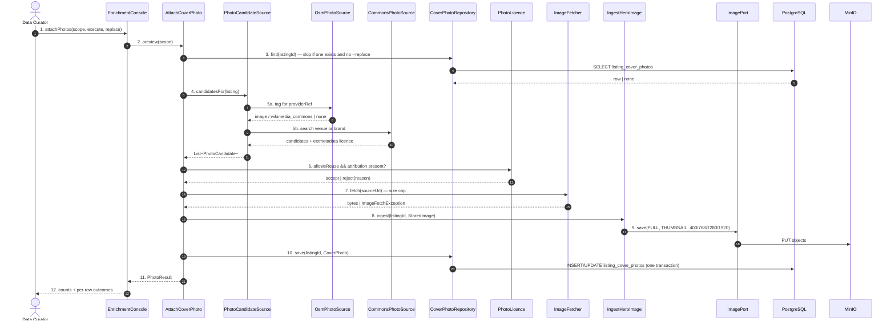
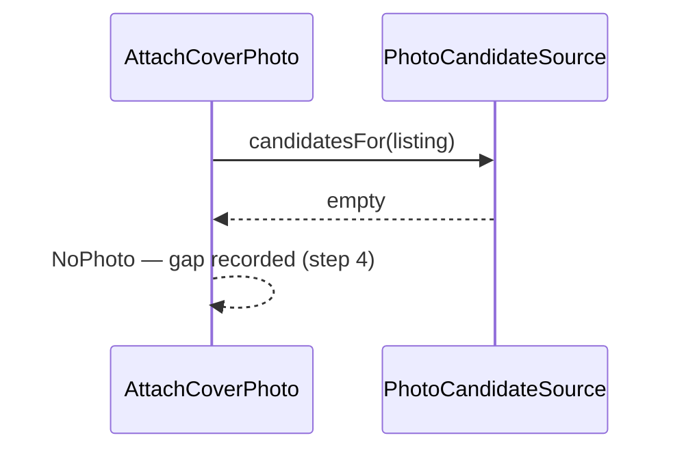
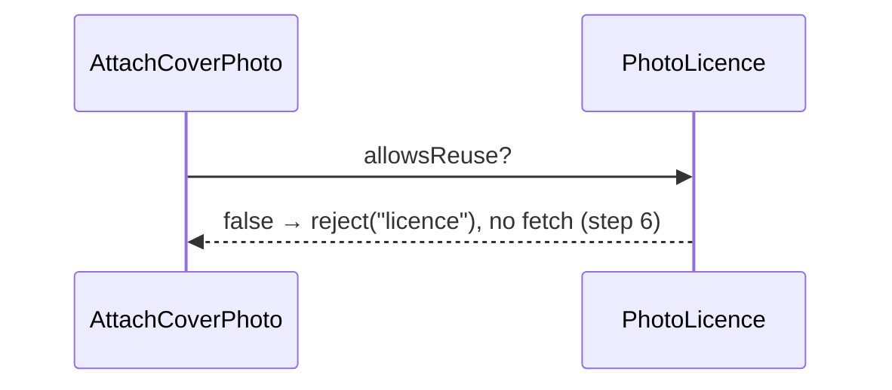
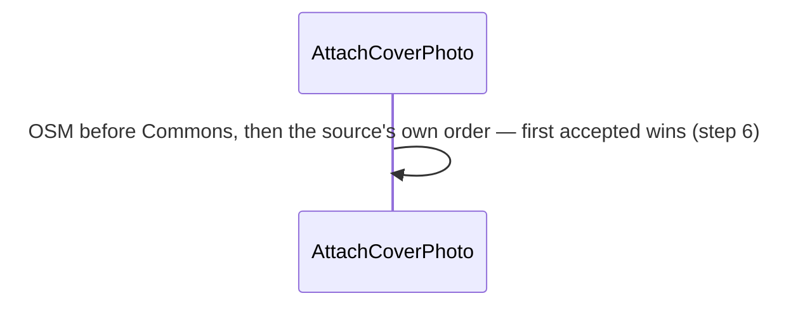
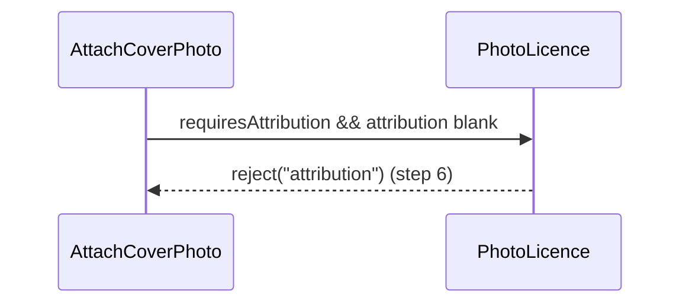
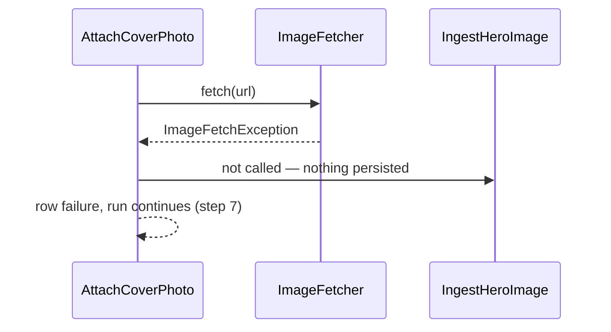
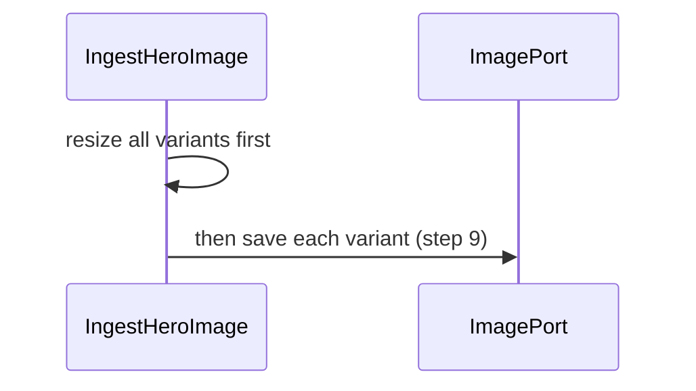
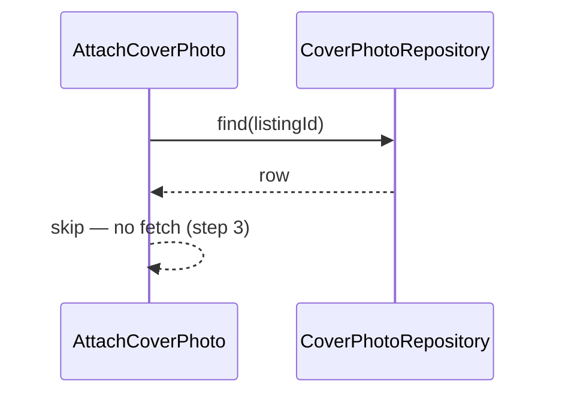
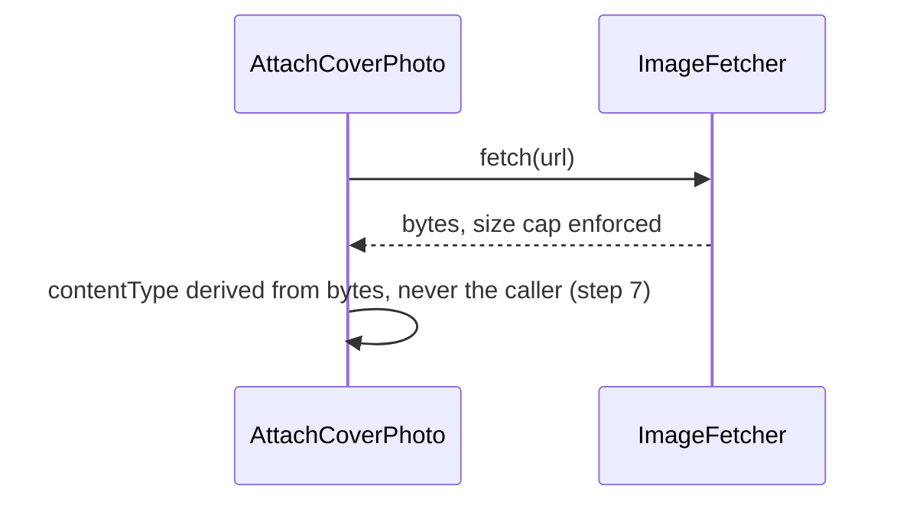

# SC-231 — Phase 6: White-box — UC-03 Attach a licensed cover photo

> **Purpose:** how the photo pass is served, class by class · **Derived from:** 05 + 04/UC-03 · **Delta:** new
> **Consistency:** one photo per listing (repository PK), credit mandatory for licences that require it, and the object store is written only after every variant has been produced.

**A1 — no candidate anywhere** · a gap, not a placeholder.

**A2 — licence unknown or non-free** · refuse before fetching bytes.

**A3 — several acceptable candidates** · deterministic ordering.

**A4 — CC-BY with no credit line** · a licence breach is not a nit.

**E1 — fetch or decode fails** · reported, existing photo kept.

**E2 — partial variant write** · impossible.

**P1 — the listing already has a photo** · untouched without `--replace`.

**P2 — a hostile or oversized image** · bounded and type-derived.

**Transaction boundary.** Two stores, so the order is fixed and must be
recoverable:

1. object bytes are written first (idempotent per key — a retry overwrites);
2. the credit row is written in its own DB transaction.

A crash between 1 and 2 leaves orphan object bytes and no credit row: the next
run refetches and overwrites them. A crash inside 2 leaves no row, so the photo
is not visible — never a visible photo with no credit.

**State transition:** `Loaded → PhotoPending → Photographed`, or `→ NoPhoto`.
The listing's trust state is untouched.

**Authorization:** local operator; `--execute` is the only gate (preview writes
nothing). No HTTP surface.

| Phase-4 flow | Class operation and error |
|---|---|
| main | `AttachCoverPhoto.preview/execute` → `PhotoCandidateSource.candidatesFor` → `PhotoLicence.allowsReuse` → `ImageFetcher.fetch` → `IngestHeroImage.ingest` → `CoverPhotoRepository.save` |
| A1 no candidate | both sources return empty; `NoPhoto`, gap recorded |
| A2 non-free licence | `PhotoLicence` has no member for it → `reject("licence")`; no bytes fetched |
| A3 several candidates | ordered OSM → Commons, then source order; first accepted wins |
| A4 CC-BY without credit | `PhotoLicence.requiresAttribution` true and attribution blank → `reject("attribution")` |
| E1 fetch/decode failure | `ImageFetchException` or `IllegalArgumentException` from `ImageResizer` → row failure, existing photo kept, run continues |
| E2 partial variants | `IngestHeroImage` resizes every width before the first `ImagePort.save` |
| P1 existing photo | `CoverPhotoRepository.find` short-circuits before any network call |
| P2 hostile image | `ImageFetcher` size cap; `ImageResizer.contentType` derives the media type from bytes, never the caller |
