# SC-231 — Phase 6: White-box — UC-03 Give a listing a photo it is allowed to show

> **Purpose:** how the photo pass is served, class by class · **Derived from:** 05 + 04/UC-03 · **Delta:** new
> **Consistency:** one photo per listing; an owner photo is never touched; a Places photo is cache-only and never served after `expiresAt`; bytes are written only after every variant is produced.

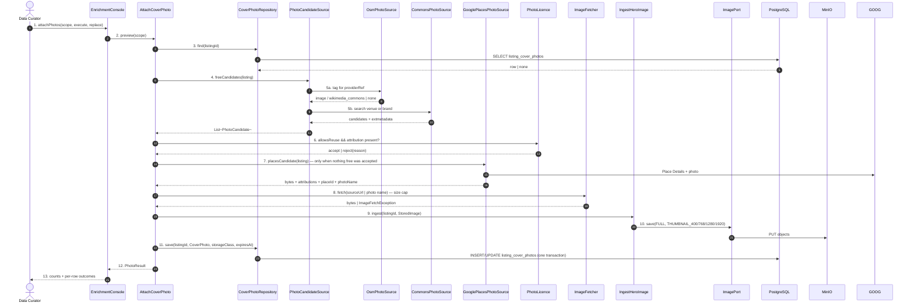
**A1 — owner photo present** · short-circuit before any network call.
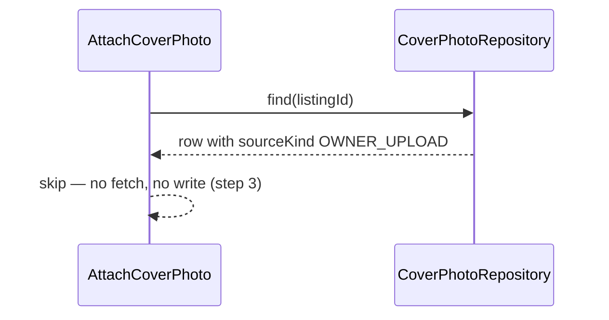
**A2 — nothing found** · a gap.
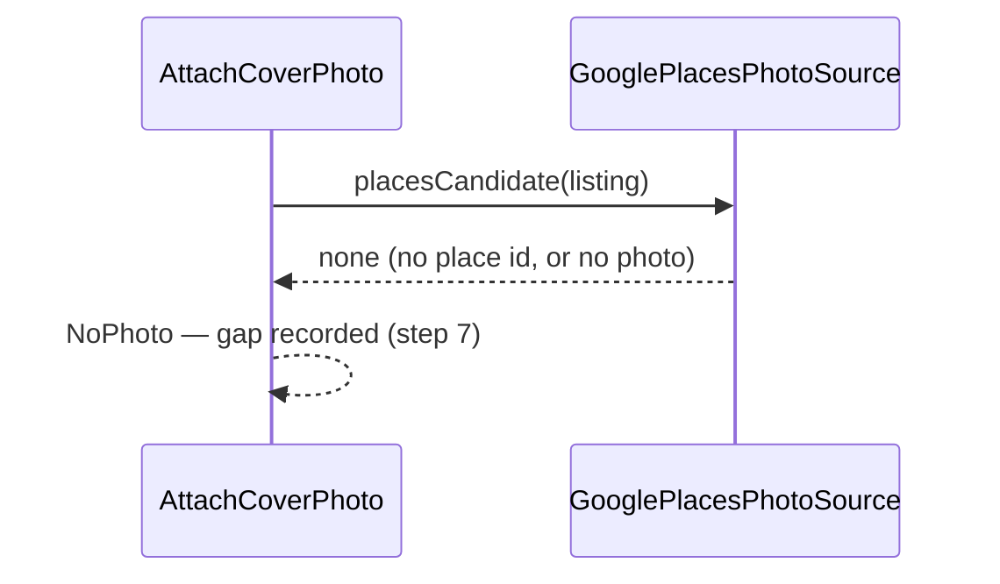
**A3 — non-free licence** · refused before bytes.
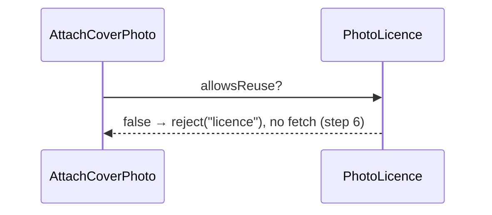
**A4 — two free candidates** · deterministic order.
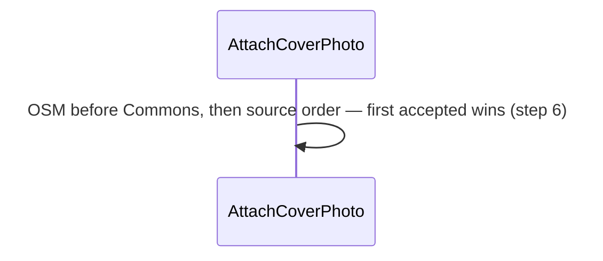
**A5 — CC-BY without credit** · rejected.
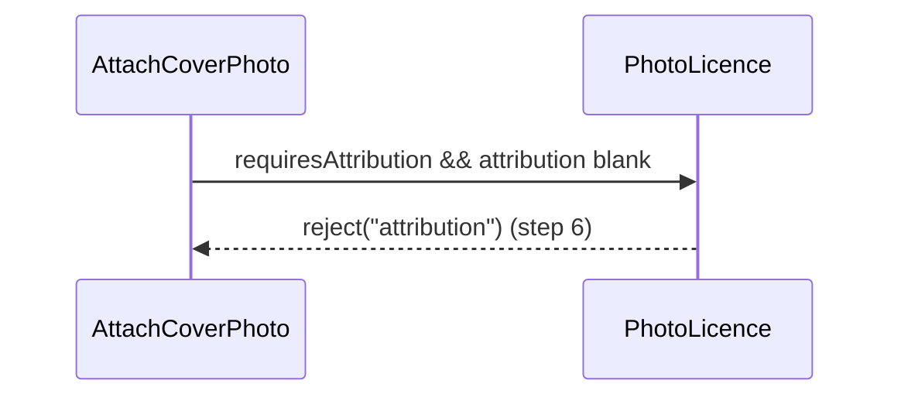
**A6 — Places wins** · cache class, expiry set.
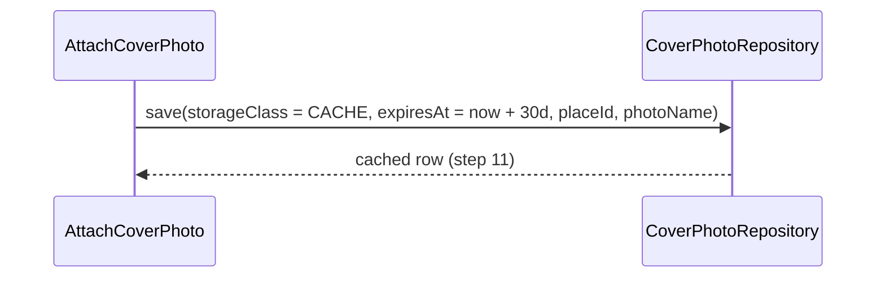
**E1 — fetch or decode fails** · reported, unexpired bytes kept.
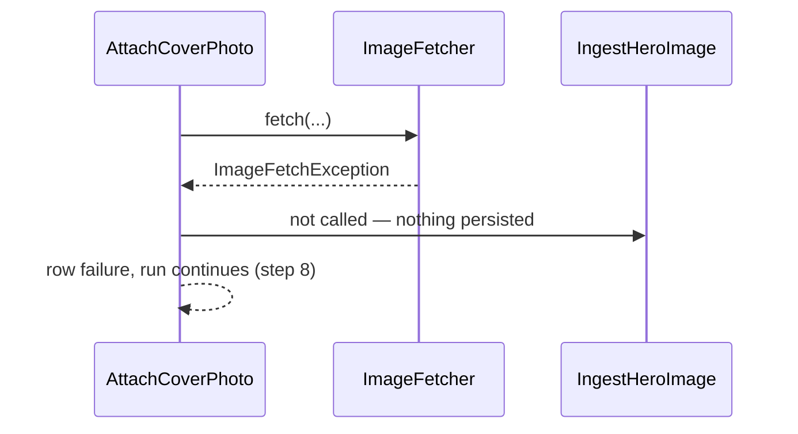
**E2 — Places quota or key failure** · row-scoped.
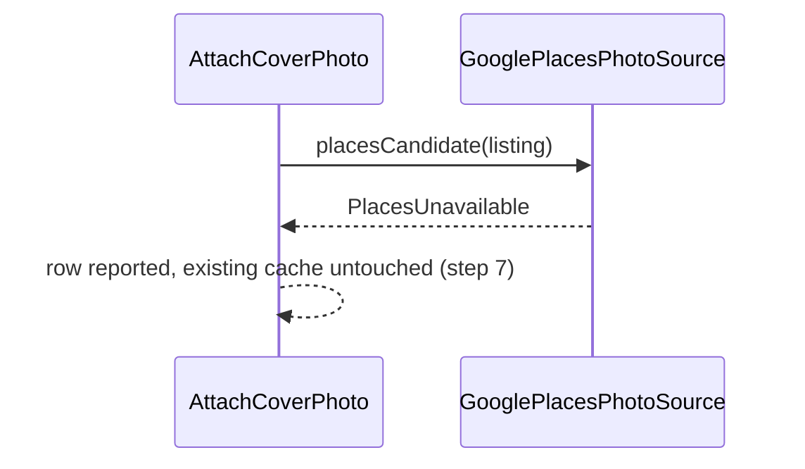
**P1 — serving an expired cache** · refused at read time.
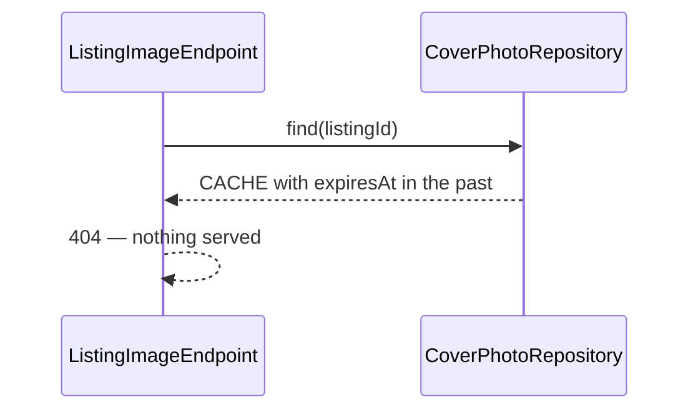
**P2 — partial variants** · impossible.
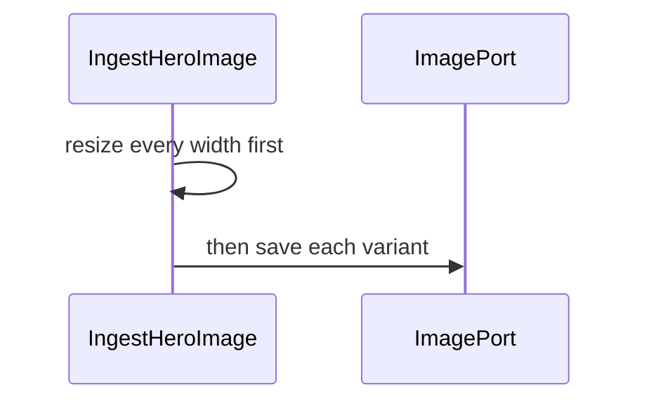
**P3 — owner uploads over a cache** · the cache row is replaced.
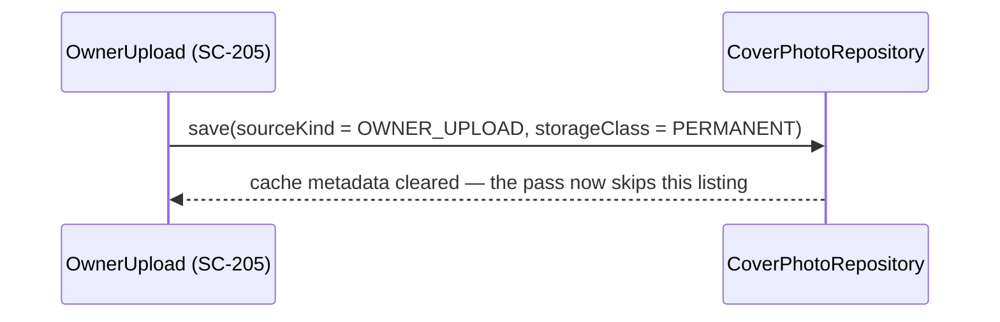

**Transaction boundary.** Two stores, so the order is fixed and recoverable:

1. object bytes are written first (idempotent per key — a retry overwrites);
2. the credit row is written in its own DB transaction.

A crash between 1 and 2 leaves orphan bytes and no row, so nothing is served and
the next run rewrites them. A crash inside 2 leaves no row — never a visible
photo with no credit.

**Serving rule.** `ListingImageEndpoint` serves a `CACHE` photo only while
`now < expiresAt`; after that it returns no photo until the pass refreshes. It
never calls Google itself, so a Places outage cannot slow a page load.

**Authorization:** local operator; `--execute` is the only gate. The Places key
is read from the server environment and never reaches the browser.

| Phase-4 flow | Class operation and error |
|---|---|
| main | `AttachCoverPhoto.preview/execute` → `PhotoCandidateSource` → `PhotoLicence` → `GooglePlacesPhotoSource` → `ImageFetcher` → `IngestHeroImage` → `CoverPhotoRepository.save` |
| A1 owner photo | repository returns `OWNER_UPLOAD`; the use case returns `Skipped` before any source is queried |
| A2 nothing found | every source empty → `NoPhoto`, gap |
| A3 non-free licence | `reject("licence")`, no bytes fetched |
| A4 several candidates | OSM → Commons → Places, first accepted |
| A5 missing credit | `reject("attribution")` |
| A6 Places wins | `storageClass = CACHE`, `expiresAt = now + 30d` |
| E1 fetch/decode failure | `ImageFetchException` / `ImageResizer` rejection → row failure, unexpired bytes kept |
| E2 Places failure | `PlacesUnavailable` → row reported; existing cache untouched; run continues |
| P1 expired cache | the endpoint refuses to serve; placeholder |
| P2 partial variants | resize-all-then-save |
| P3 owner upload | SC-205 writes `OWNER_UPLOAD`/`PERMANENT`; the pass's `find` then short-circuits |
