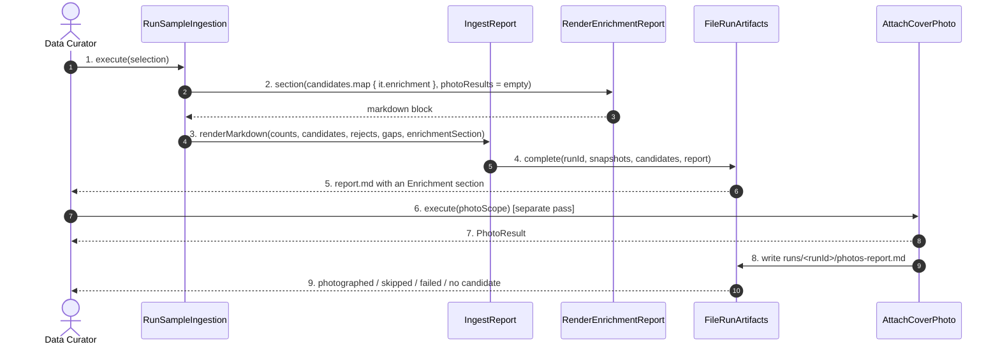

# SC-231 — Phase 6: White-box — UC-04 Review enrichment outcomes

> **Purpose:** how the report is produced, class by class · **Derived from:** 05 + 04/UC-04 · **Delta:** new report section; run artifacts unchanged in shape
> **Consistency:** the report is rendered from the same `EnrichmentDecision` objects the candidates carry, so it cannot claim something the batch does not hold (INV-14).

**State transition:** none in the catalogue; the report is a projection of the
batch plus the photo pass result.

**Transaction boundary:** `FileRunArtifacts.complete` writes atomically (temp +
rename) and writes `run.json` last; a run directory without `run.json` is
incomplete and is never offered for review. The photo pass writes its own file
and never mutates the ingestion run's artifacts.

**Authorization:** local operator.

| Phase-4 flow | Class operation and error |
|---|---|
| main 2–4 | `RenderEnrichmentReport.section` groups admitted rows by `VenueType`, excluded rows by `VenueClass` with the deciding evidence, lists undecided rows, and counts evidence classes |
| A1 nothing admitted | the section prints "no row in this run could be admitted" — it is always present, never omitted |
| A2 large excluded share | the section prints admitted / excluded / undecided shares and the top exclusion reasons |
| A3 stored value differs | the load records both; `RenderEnrichmentReport` prints `decision=… stored=… (kept)` |
| E1 report not writable | `FileRunArtifacts.complete` throws; the run has no `run.json`, so it is not pending and cannot be loaded |
| P1 photo pass not run | the photo summary is rendered from a null result as "photo pass not run for this batch" |
