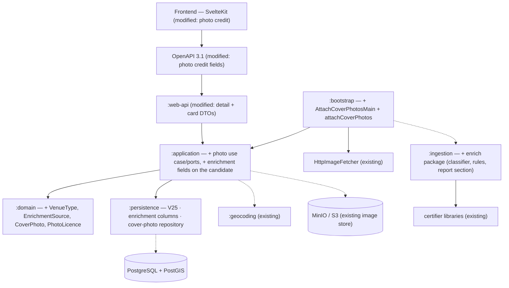

# SC-231 — Phase 7: Complete class diagram (the ultimate design)

> **Purpose:** the implementation design — layers, names, persistence, API · **Derived from:** 05–06 · **Delta:** new `:domain` vocabulary + `:application/photo`; modified `:ingestion/pipeline`, `:persistence`, `:web-api`; new `:bootstrap` CLI

## Layer map

## Module map

| Module | Status | Contents |
|---|---|---|
| `:domain` | **modified** | new `VenueType` (closed vocabulary + `servesMeals`), `EnrichmentSource` (+`isWeak`), `PhotoLicence` (+`allowsReuse`/`requiresAttribution`), `CoverPhoto`; `RestaurantListing` gains `venueType`, `venueTypeSource`, `cuisineSource`, and `coverPhoto`; `imported(...)` accepts the enrichment fields |
| `:application` | **modified** | `IngestionCandidate` gains `enrichment: EnrichmentDecision?`; new `com.tahirslist.application.photo`: `AttachCoverPhoto` (`preview`/`execute`), `PhotoCandidateSource`, `CoverPhotoRepository`, `PhotoCandidate`, `PhotoReview`/`PhotoResult`; `RestaurantListingRepository.applyBatch` gains the enrichment write + the non-serving index rule |
| `:ingestion` | **modified** | new `com.tahirslist.ingestion.enrich`: `EnrichCandidate`, `VenueTypeClassifier`, `CuisineAssigner`, `EnrichmentRules` (curated tables), `EnrichmentDecision`; `CandidateFactory` calls `EnrichCandidate`; `IngestReport` renders the Enrichment section |
| `:persistence` | **modified** | `V25__sc_231_enrichment.sql`; `ExposedCoverPhotoRepository`; `applyBatch` writes `venue_type`, `venue_type_source`, `cuisine_source`, and skips the search-mirror row for non-serving types; `Tables.kt` gains `CoverPhotos` |
| `:web-api` | **modified** | `DetailResponse` gains `photoAttribution`, `photoLicence`, `photoSourceUrl`; `BrowseCard`/`SearchCard` gain `photoAttribution`; OpenAPI regenerated |
| `:bootstrap` | **modified** | `AttachCoverPhotosMain` + `:bootstrap:attachCoverPhotos`; `scripts/attach-cover-photos.sh`; `OsmPhotoSource`, `CommonsPhotoSource` wired to the existing `HttpImageFetcher` |
| frontend | **modified** | detail hero shows the credit line; cards show a small credit caption when present |
| `:geocoding` · certifier libraries | **unchanged** | reads only |

## Persistence delta

| Element | Status | Detail |
|---|---|---|
| `V25__sc_231_enrichment.sql` | **new** | `restaurant_listings.venue_type VARCHAR(24) NULL` CHECK in (`RESTAURANT`,`CAFE`,`FAST_FOOD`,`BAKERY`,`GROCERY`,`MARKET`,`BUTCHER`,`CATERER`,`OTHER`); `venue_type_source VARCHAR(24) NULL` CHECK in (`SOURCE_CATEGORY`,`OSM_FEATURE`,`BRAND_MAP`,`NAME_KEYWORD`); `cuisine_source VARCHAR(24) NULL` same CHECK; partial index on `venue_type` where not null |
| `listing_cover_photos` | **new table** | `listing_id UUID PRIMARY KEY REFERENCES restaurant_listings(id) ON DELETE CASCADE`; `source_kind VARCHAR(16)` CHECK (`OSM`,`WIKIMEDIA`); `source_url VARCHAR(1024)`; `licence VARCHAR(16)` CHECK (`CC0`,`PUBLIC_DOMAIN`,`CC_BY`,`CC_BY_SA`); `author VARCHAR(512)`; `attribution VARCHAR(1024) NOT NULL`; `retrieved_at TIMESTAMPTZ`; `content_hash CHAR(64)`; `width INT`, `height INT`; `created_at TIMESTAMPTZ`. PK gives INV-9 for free |
| `listing_search` | **unchanged** | no column: non-serving types are simply not mirrored (D-6). Rejected alternative below |
| `restaurant_listings` (other columns) | **unchanged** | `cuisine` already exists and holds the derived value; `price`/`rating`/`is_delivery`/`alcohol_served`/`halal_scope` are untouched (no source claims them) |
| `Tables.kt` | **modified** | add `CoverPhotos` |

**Rejected:** adding `venue_type` to `listing_search` and filtering in the query.
It changes the search SQL (SC-199's quantization work) for a product decision
that is still open (Q-4); skipping the mirror row achieves the same default
without touching the search path.

## API delta (OpenAPI 3.1)

| Element | Status | Detail |
|---|---|---|
| `DetailResponse.photoAttribution` | **new** | string, nullable — the credit line a licence requires |
| `DetailResponse.photoLicence` | **new** | enum string, nullable — `CC0`/`PUBLIC_DOMAIN`/`CC_BY`/`CC_BY_SA` |
| `DetailResponse.photoSourceUrl` | **new** | string (uri), nullable — where the photo came from |
| `BrowseCard.photoAttribution` / `SearchCard.photoAttribution` | **new** | string, nullable — rendered as a small caption |
| `venueType`, `cuisineSource` | **not exposed** | Q-5/Q-4 open; stored and reported only |
| `GET /v1/listings/{id}/image` | **unchanged** | already serves the variants; the photo pass just fills them |

## Frontend delta

| Element | Status | Detail |
|---|---|---|
| `routes/restaurants/[id]/+page.svelte` | modified | a credit line under the hero when `photoAttribution` is present |
| `lib/components/listing/ListingCard.svelte` (and search card) | modified | a small caption/overlay when `photoAttribution` is present |
| `lib/api/schema.d.ts` | regenerated | `pnpm codegen:api` |

## Behaviour deltas the diagrams imply

| # | Delta | Where |
|---|---|---|
| D-b1 | The candidate carries an enrichment decision; the load writes it only over nulls | `:application` |
| D-b2 | Non-serving venue types are not written to the search mirror | `:persistence` |
| D-b3 | The report always contains an Enrichment section, even when empty | `:ingestion` |
| D-b4 | A listing may have exactly one credit row | `:persistence` |
| D-b5 | Cards and detail render a credit line when the licence requires one | frontend |

## Dependency recorded, not designed around

`GeocodedPlace` on `main` carries `location`, `displayName`, `providerRef`. The
OSM `osm_key`/`osm_value` used by UC-01 step 3 is added by **SC-227 (PR #84)**.
Until it merges, `typeForOsm` is never reached and classification rests on
category + name — a real reduction in evidence quality, stated in the report as
`OSM_FEATURE: not available in this run` rather than silently degraded.
