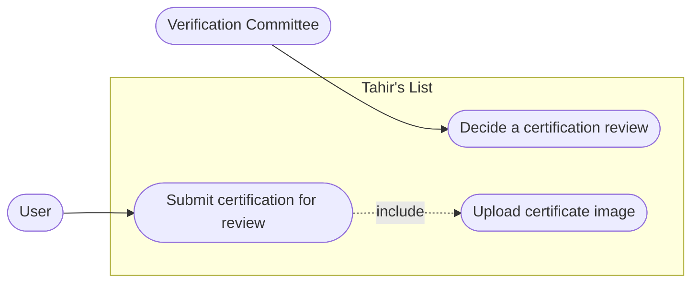
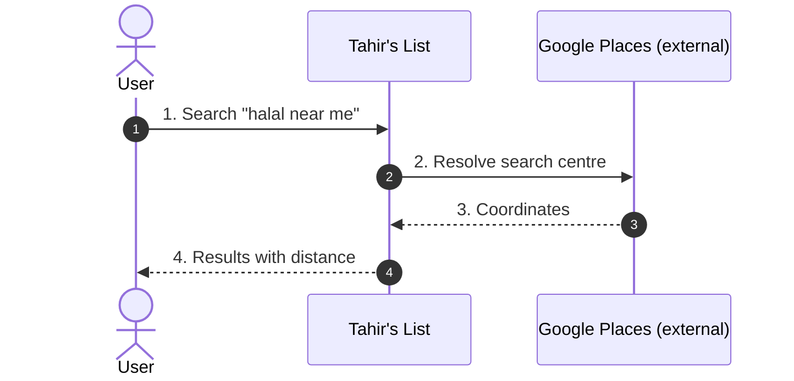
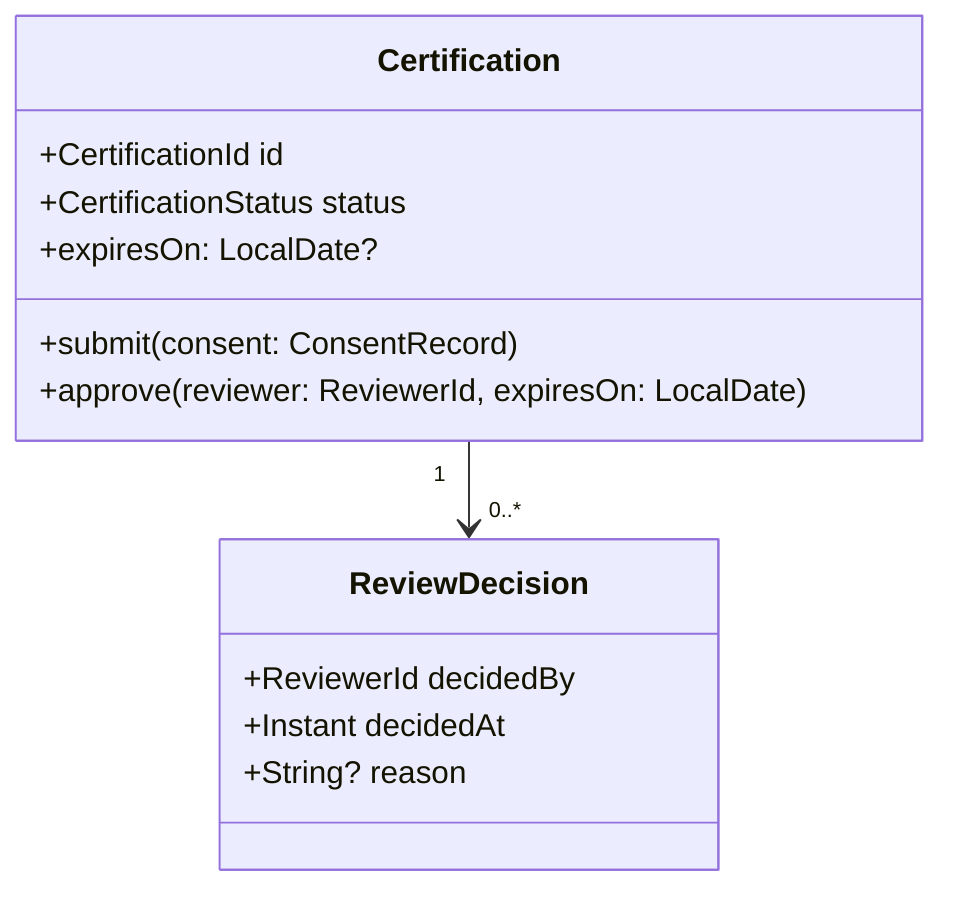
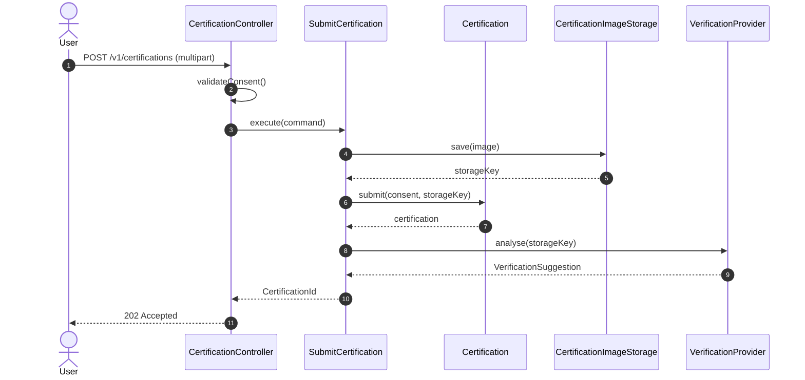

# Feature Workflow — design-first, diagram-driven, PR-gated, deployed

> **Ratified by the founder on 2026-11-07. Enforcement: advisory.**
> This is a strong default for a feature, not a gate on every commit. It applies
> when someone invokes it (`@tahirs-feature-workflow` or `/feature`), not
> automatically. See §1.

A feature is designed on paper before a line of it is written: the domain model,
the use cases, the diagrams that show how the system behaves and how it is
shaped, and a complete class diagram that doubles as the implementation plan.
The founder is walked through all of it once and approves the design. Then it is
implemented test-first, reviewed in cycles until convergence, merged, and
verified on the dev environment.

## 1. Ratification and enforcement

**What "ratified" means here.** The founder has approved this as the team's
default way to run a feature. It is the honest description of how we want work to
happen, not a compliance mechanism.

**What is enforced: nothing automatic.** There is no CI gate, no required label,
no blocking checklist. The enforcement is a set of nudges:

- the **skill** (`@tahirs-feature-workflow`) that loads this procedure on demand;
- the **command** (`/feature SC-131`) that starts it in one line;
- the **artifact layout** (`docs/features/<STORY-ID>/`), so a half-finished
  feature is visible as missing files;
- the **checklists** (Appendices D and G), so "done" has a shape;
- the **definition of convergence** (§11), so review arguments have a stopping
  point;
- the **walkthrough/approval record**, so an approved design is a commit rather
  than a memory.

**What this deliberately does not do.** It does not run for typo fixes, copy
tweaks, colour changes, dependency bumps, or chores. The skill is hidden from
automatic invocation and must be asked for. An agent that starts producing UML
for a one-line fix has misread the room.

**Amendment.** Open a PR against this file with a one-paragraph rationale and the
founder's approval, set `status: proposed` while it is under review, and update
`ratified.on` when it lands. Change the document before changing practice; do not
quietly work around it.

## 2. The one-line summary

> Requirement → **domain model** → **use cases** → **use case diagram** →
> **black-box sequence diagrams** (one per use case) → **system class diagram** →
> **white-box sequence diagrams** (one per black-box) → **complete class diagram**
> → **walkthrough to the founder** → **founder approves the ultimate design** →
> **work items** → **implementation (backend TDD, then frontend)** →
> **PR review cycles to convergence** → **merge** → **deploy to
> dev.tahirslist.com and verify**.

## 3. How to invoke it

Three equivalent triggers, in increasing order of typing:

```text
@tahirs-feature-workflow SC-131
```

```text
/feature SC-131
```

```text
Run the feature workflow for SC-131: produce the full design package, walk me
through every diagram, and stop for my approval before implementing.
```

The skill is the substance; the command is a one-line trigger. Either way the
agent must confirm the story before designing (Phase 0) and must stop for
approval before implementing (Phase 8).

When the design is approved, the continuation is:

```text
Design approved. Implement the work items with TDD, run the PR review cycles to
convergence, merge, deploy to dev.tahirslist.com and verify.
```

## 4. Division of labor

| Who | Does |
|-----|------|
| **Implementing agent** (backend/frontend specialist) | Produces phases 0–7 (all diagrams), runs the self-check, writes the walkthrough, implements with TDD, opens PRs, drives review rounds, merges after convergence, deploys and verifies |
| **Founder** | Hears the walkthrough, decides the open questions, **approves the ultimate design**, and is the escalation point when a design choice or a review disagreement cannot be settled |
| **Adnan (PM/EM)** | Confirms the story is real and in scope; keeps the artifact set honest; escalation |
| **Omar / Yusuf / Fatima / Maryam** | Independent review passes on implementation PRs (security, runtime QA, UX, frontend idiom). Design-phase input is consultative only — the founder is the approver |

The design phase has **no approval gates between diagrams**. The agent
self-checks against Appendix D, and the only human decision point is the
walkthrough in Phase 8. One coherent design review beats seven partial ones, and
it keeps the diagrams consistent with each other.

## 5. Non-negotiable rules (within an invocation)

Once the workflow is invoked, these are the rules. They are what makes the
artifacts worth producing:

1. **Design before code.** No implementation commit exists before the ultimate
   design is approved.
2. **Each phase is a committed artifact.** A diagram that lives only in a chat
   message does not exist.
3. **Black-box diagrams never name internals.** Only the actor, the system, and
   external services.
4. **White-box diagrams never invent classes.** Every participant must exist in
   the system class diagram. If one is missing, update the class diagram *first*,
   record the delta, then redraw.
5. **One use case = one black-box diagram = one white-box diagram.** No bundling,
   no orphans.
6. **Every implementation work item traces to a use case step.** No work item
   without a use case, an acceptance criterion, and a named test.
7. **Backend tests come first; frontend starts from the merged API contract.**
8. **A PR that changes behavior without updating its diagrams is blocking.**
9. **Unknowns are recorded as unknowns** with an owner and a decision deadline,
   and escalated. They are never filled with a plausible guess — not even to make
   a diagram look finished.
10. **No merge without convergence, no feature without a verified deploy**
    (§11, §12).
11. **The approval is explicit.** A walkthrough that ends with "looks good"
    without an approval line recorded in `08-design-walkthrough.md` is not an
    approval.

## 6. Artifact layout

One folder per feature, named after the Shortcut story:

```
docs/features/<STORY-ID>/                 e.g. docs/features/SC-131/
  00-story.md                            Shortcut link + verbatim acceptance criteria
  01-domain-model.md                     Phase 1
  02-use-cases.md                        Phase 2 (all use cases, one section each)
  03-use-case-diagram.md                 Phase 3
  04-blackbox/
    UC-01-<slug>.md                      Phase 4 (one file per use case)
    UC-02-<slug>.md
  05-class-diagram-system.md             Phase 5 (conceptual/system class diagram)
  06-whitebox/
    UC-01-<slug>.md                      Phase 6 (1:1 with 04-blackbox/)
    UC-02-<slug>.md
  07-class-diagram-complete.md           Phase 7 (the ultimate design)
  08-design-walkthrough.md               Phase 8 (walkthrough + approval record)
  09-work-items.md                       Phase 9
  10-traceability.md                     Living matrix, updated through deploy
```

Conventions:

- **IDs:** use cases are `UC-01`, `UC-02`, … unique within the folder; work items
  are `WI-01`, …; flows are `UC-01.M` (main), `UC-01.A1` (alternate),
  `UC-01.E1` (exception).
- **Diagrams:** authored as **Mermaid inside the Markdown file**, so GitHub
  renders them in the PR diff with no toolchain. If a diagram genuinely exceeds
  Mermaid (very large class diagrams), use PlantUML in a sibling `.puml` rendered
  in a container — never a binary-only image as the source of truth.
- **Existing features:** reuse and update the existing folder; do not fork a new
  one.
- **One feature folder = one narrative.** If the story grows past ~8 use cases,
  split the story.

## 7. Design phases (0–7)

The agent produces these in order, self-checking each against Appendix D. The
gates below are **internal consistency checks**, not approval meetings — but a
failed check stops the pipeline, because every later diagram depends on the ones
before it.

### Phase 0 — Intake and story lock (Shortcut)

**Produce:** `00-story.md` — Shortcut link, story ID, epic, iteration, priority,
personas, the acceptance criteria **verbatim**, edge cases, and known unknowns
with owners.

**Method:** confirm the story exists in Shortcut and is in an epic *and* an
iteration (founder rule). Confirm priority against the User Story Prioritization
(Product) and Use Case Prioritization (Development Process) docs. Do not start
design on a story that only exists in a chat thread.

**Check:** acceptance criteria are testable; edge cases listed; every unknown has
an owner; nothing about the requirement is invented.

### Phase 1 — Domain model

**Produce:** `01-domain-model.md` — technology-free.

Must contain:

- **Aggregates** and their consistency boundaries, **entities**, **value
  objects**, and **domain events** (if any).
- **Relationships** with multiplicity and direction, in words plus a Mermaid
  `classDiagram` of the conceptual model.
- **Invariants** — rules that must always hold, stated so they can become test
  names.
- **State machines** for anything with a lifecycle (e.g. the certification review
  `SUBMITTED → AI_REVIEW → AI_SUGGESTED → HUMAN_REVIEW → APPROVED/DENIED`, and
  `REVERSED`), including allowed transitions and guards.
- **Glossary** — every domain term the use cases will use, defined once.
- **Reconciliation** with `ARCHITECTURE.md` §1.2: state explicitly whether this
  feature leaves the agreed model unchanged, extends it, or changes it.

**Method:** derive nouns (entities/VOs) and verbs (invariants/events) from the
story and the PRD. No tables, no columns, no HTTP, no framework names.

**Check:** every term the use cases need is defined; every invariant is testable;
no implementation leakage; the architecture reconciliation is stated explicitly.

### Phase 2 — Use cases

**Produce:** `02-use-cases.md` — one section per use case, `UC-01`…, using
Appendix A.

Each use case must have: ID and name, primary + supporting actors, goal,
preconditions, trigger, **numbered main success scenario**, numbered alternate
flows, numbered exception flows with the resulting system state, postconditions,
business rules, data created/read/updated, linked acceptance criteria, and open
questions.

**Method:** one use case per actor goal — not per screen, not per endpoint. If a
step needs a decision the product has not made, record it as an open question
with an owner; it becomes a decision item for the walkthrough. Do not resolve it
in the use case.

**Check:** every acceptance criterion maps to at least one step or flow; every
use case has exactly one primary actor and a trigger; every flow terminates in a
defined postcondition; no open question is silently answered.

### Phase 3 — Use case diagram

**Produce:** `03-use-case-diagram.md` — this feature's use cases plus the
**updated system-wide** diagram (the Shortcut "Update Use Case Diagram" step).

Must show: the system boundary, the actors (README personas U, RO, VRO, VC, IC,
ET), the use cases, real `«include»` / `«extend»` relationships, and a legend
marking **new** vs **existing**.

**Method:** actor–use case associations mean "this actor may initiate this use
case", not "this actor benefits from it". A use case reachable only through
another is modelled with `«include»`, not as a top-level association.

**Check:** 1:1 coverage with Phase 2; actors match the persona list; the boundary
is named "Tahir's List"; new/existing marked.

### Phase 4 — Black-box sequence diagrams (one per use case)

**Produce:** `04-blackbox/UC-xx-<slug>.md` — one file per use case, with a
Mermaid `sequenceDiagram` for the main success scenario and a diagram or fragment
for **each** alternate and exception flow.

**Black-box rules:**

- Participants are only: the actor(s), **one lifeline labelled "Tahir's List"**,
  and external services treated as opaque (Google Places, Gemini vision,
  MinIO/S3, Google/Yelp reviews, the browser extension host page).
- **No** internal class, port, adapter, table, module, or method names.
- Number every message to match the use case steps (`1`, `2a`, `2b`…) so the
  mapping is mechanically checkable.
- Exception flows end in the externally visible outcome only — what the actor
  sees, and what state the world is in — not the mechanism.

**Method:** "what does the actor observe, and when?" A non-engineer should be
able to read it. If a step cannot be explained without naming an internal
component, the use case is underspecified — go back to Phase 2.

**Check:** every use case step appears as a numbered message; every
alternate/exception flow has a diagram or fragment; zero internal names; every
external dependency is visible; security-relevant flows (auth, uploads, trust
decisions, PII) are flagged in the file header.

### Phase 5 — System class diagram (conceptual)

**Produce:** `05-class-diagram-system.md` — the analysis-level class diagram.

Must contain:

- **Entity classes** from Phase 1, with their invariants as operations.
- **Control classes** — exactly one per use case (the application service),
  named after the use case goal.
- **Boundary classes** — the API surface each actor talks to.
- **Ports as interfaces** for every external dependency, plus a thin **adapter
  stub** per port (named now so the white-box diagrams can use it; specified
  with technology in Phase 7).
- Relationships with multiplicity and direction, key attributes, and the
  operations the sequence diagrams will call.
- Split into sub-diagrams when large: **domain**, **application**, **boundary**,
  plus one overview showing how they connect.

**Method:** derive from Phases 1–4 only. Every use case step must be served by an
operation on some class here. Do not add a class "for the future". Do not model
tables, columns, JSON shapes, or framework annotations — those are Phase 7.

**Check:** every Phase 1 entity appears; every use case has a control class;
every external dependency sits behind an interface; every use case step resolves
to an operation; no orphans; no framework leakage.

### Phase 6 — White-box sequence diagrams (one per black-box)

**Produce:** `06-whitebox/UC-xx-<slug>.md` — 1:1 with `04-blackbox/`.

**White-box rules:**

- Participants must be **exact classes and interfaces from Phase 5**.
- Every black-box message maps to one or more white-box messages, and every
  white-box message is annotated with the operation it invokes.
- Show: boundary → control → entity → port → adapter → external service;
  **transaction boundaries**; aggregate state transitions; authorization checks;
  persistence reads and writes (name the repository port, not the table); and how
  each exception flow becomes a concrete error (exception class → HTTP status /
  UI state).
- No new class may appear. If you need one, stop: update
  `05-class-diagram-system.md`, record the delta in its "revisions" section, then
  redraw.
- Auth: show exactly where the caller's identity is established and where the
  authorization decision is made. Never a client-supplied identity.

**Check:** 1:1 with Phase 4 including every alternate/exception flow; no invented
classes; every error path from Phase 4 is present; every write has a visible
transaction boundary; every used Phase 5 operation matches its declared
signature; deltas folded back into Phase 5.

### Phase 7 — Complete class diagram (the ultimate design)

**Produce:** `07-class-diagram-complete.md` — the design-level artifact that the
code will be written from. This is where technology enters, and this is the
diagram the founder approves.

Must contain, marked **new / modified / unchanged**:

- **Backend, per hexagonal module:** `:domain` (aggregates, VOs, domain
  exceptions), `:application` (use cases, ports, application exceptions),
  `:persistence` (JDBC repositories, row mappers, SQL), `:bootstrap`
  (controllers, request/response DTOs, routes, config/beans, security wiring),
  and any adapter module. Include concrete port implementations.
- **Persistence delta:** tables, columns, constraints, indexes, and the Flyway
  migration(s) — by name, in order.
- **API contract delta:** endpoints, methods, request/response shapes, error
  codes, and the resulting OpenAPI 3.1 change.
- **Frontend:** routes, `+page.svelte` / component tree, `*.svelte.ts` stores,
  generated API client functions and types, load functions, and the UI states
  (loading / empty / error / unauthorized / unverified).
- **The contract in the middle:** which frontend client call binds to which
  endpoint, so backend and frontend work items can be cut cleanly.
- **Config and environment:** new keys, secrets, feature flags — and whether they
  must exist on the dev stack before deploy.

**Method:** take Phase 5 + 6 and add the implementation decisions. Every class
must be needed by a Phase 6 message or a work item. Naming is final — these names
go into the code, so argue about them now. Any architecture decision that changed
(new module, new external dependency, new trust boundary) goes into
`ARCHITECTURE.md` Part 1 in the same PR.

**Check:** an implementer could write the code from this diagram plus the
white-box sequences with **no design decisions left open**; every Phase 6
participant appears; every table/column/endpoint delta is listed; the OpenAPI
delta is listed; the frontend tree is complete enough to cut work items;
`ARCHITECTURE.md` is updated if a decision changed.

## 8. Phase 8 — The walkthrough and design approval

This is the only human approval gate in the design half. Nothing is implemented
until it passes.

**Produce:** `08-design-walkthrough.md`.

**Method — walk the founder through all diagrams, in this order:**

1. **Story and domain model** — what problem, which terms, which invariants, what
   changes in the agreed domain model.
2. **Use cases** — each one, its flows, and the open product questions it raised.
3. **Use case diagram** — the new use cases against the existing system.
4. **Black-box sequences** — the actor-visible behavior, flow by flow.
5. **System class diagram** — how the system is shaped: entities, one control
   class per use case, boundaries, ports.
6. **White-box sequences** — how each use case is actually served, including
   transactions, authz, and error paths.
7. **Complete class diagram** — modules, migrations, API contract, frontend tree,
   config. **This is the design being approved.**

For each diagram the walkthrough states, in one block:

- **What it shows** — two or three sentences, no jargon dump.
- **What it locks in** — the decisions that become expensive to change later.
- **What I need from you** — `approve` / `choose between X and Y` / `correct`,
  with a recommendation and its trade-off.
- **Known gaps** — anything deliberately left open, and where it is tracked.

**Then the approval.** The walkthrough ends with a numbered list of decision
items — every open question from Phases 1–7 that cannot be answered
technically — and an explicit request:

> **Design approval requested.** Reply `approved` to start implementation, or
> name the diagram and the change.

**Response handling:**

| Founder says | Agent does |
|---|---|
| `approved` | Record the approval block (Appendix F), set status `approved`, proceed to Phase 9 |
| Change to a diagram | Re-run that phase, redraw every downstream diagram that references it, update the walkthrough, re-request approval |
| New requirement | Stop. It is not a design change — it goes to Shortcut as a story (or an AC amendment) first |
| Silence on an open question | It stays open; the agent may not decide it silently |

**Approval record** (in `08-design-walkthrough.md`):

```
Approved by: founder
Date: 2026-11-XX
Design commit: <git sha of the design PR merge>
Scope: phases 1-7 for SC-XXX
Decision items resolved: D-1 ... D-n (see table above)
```

The design PR is merged with the approval recorded on it, so the approved design
is a commit, not a conversation. Approval is **per design**, not per PR: any
later design change invalidates it and requires a delta walkthrough.

## 9. Phase 9 — Work item breakdown

**Produce:** `09-work-items.md` — the implementation plan, using Appendix B.

Rules:

- **Backend first, in dependency order:** migration → domain → application use
  case (with its tests) → persistence/adapter → controller + OpenAPI → security
  wiring. Each is its own work item and its own small PR.
- **Each work item carries:** ID, title, layer (backend/frontend), the use case
  steps it implements, the **names of the failing tests to write first**,
  acceptance criteria, dependencies, expected PR scope, risk level, and reviewer
  notes (security-relevant or not).
- **Frontend items come after the API contract is merged** (or after the OpenAPI
  spec is committed in the backend PR). Order: regenerate the typed client →
  load functions → components → interaction states → a11y → tests.
- Every use case step is covered by at least one work item; every Phase 7 class
  is assigned to exactly one work item.
- No work item larger than one reviewable PR. If it cannot be reviewed in one
  sitting, split it.
- WIP limit: one feature in implementation per agent.

**Check:** two-way coverage (UC step ↔ work item, class ↔ work item); every work
item has test names and acceptance criteria; ordering and PR sequence agreed.

## 10. Phase 10 — Implementation

**Produce:** code, tests, migrations, OpenAPI spec, and PRs.

**Method:**

1. Branch `feat/<STORY>-<slug>` (or `fix/…`), one branch per work item or per
   small group.
2. **Backend TDD:** write the failing test first and show it fails for the right
   reason; implement; go green; refactor. Frontend: test behavior and edge
   states, not markup.
3. Run the formatter before every commit; commit only on a green build, with
   `[SC-###]` + imperative, capitalized, ≤50 chars, no trailing period.
4. Open the PR with Appendix C: story link, work item, use case and diagram
   links, acceptance criteria, attribution line, security/QA notes, and evidence.
5. **Green build on the PR head before requesting review.** Run the full
   containerized suites, not a subset:
   `./scripts/backend-test.sh` and `./scripts/frontend-test.sh`.
6. Immediately update `10-traceability.md` with the PR number — not at the end.

## 11. Phase 11 — PR review cycles to convergence

Review is **round-based**. One round = one reviewer verdict on a given PR head.
Findings are classified:

- **Blocking** — incorrect behavior, unmet acceptance criterion, security issue,
  missing/incorrect test, broken traceability, diagram divergence, red or flaky
  build, undocumented API/DB change.
- **Non-blocking** — naming, style, organization, optional simplification,
  follow-up suggestion. Labeled `nit:` or `optional:`.

**Rounds:**

| Round | Reviewer | Focus |
|-------|----------|-------|
| 0 | Author (agent) | Self-review of the diff before requesting review: every changed line is traceable to a work item, no debug leftovers, docs/diagrams updated |
| 1 | Omar | Static: vulnerability classes, authz placement, data exposure, secrets, injection, trust boundaries, dependency risk |
| 2 | Yusuf | Dynamic: acceptance criteria against real behavior in containers, regression, edge/attack cases from Omar, honest evidence |
| 3+ | Author + reviewers | Fix verification, clean-round confirmation |
| UI PRs | Fatima | UX, a11y, trust-language consistency, design tokens |
| Frontend PRs | Maryam | SvelteKit idiom, state/SSR safety, typed client usage |

**Convergence** means all of the following at once:

1. No unresolved **blocking** thread.
2. Every acceptance criterion in scope is verified by a passing automated test,
   or by recorded manual verification with evidence (command, output,
   screenshot).
3. The use cases in scope are covered in the traceability matrix, and the named
   tests exist and pass.
4. The full containerized suites are green on the PR head, and the PR is
   mergeable.
5. A recorded `Verdict: APPROVE` from the assigned reviewer, and from Omar for
   security-sensitive work. (On the shared GitHub account, an attributed comment
   stating `Verdict: APPROVE` **is** the approving review — see the AGENTS.md
   workaround.)
6. **Two consecutive review rounds introduce zero new blocking findings.** This
   distinguishes convergence from "the author stopped replying".
7. No behavior change is unaccompanied by a diagram + traceability update.
8. Every deferral exists as a Shortcut story, not a `TODO` in code.

**If it does not converge after 3 rounds:** escalate to Adnan with a written
summary of the disagreement and a proposed resolution. Do not keep pushing
commits into a loop, do not split the difference on a security finding. If the PR
is simply too large to converge, split it along work-item lines and restart the
loop on the smaller PRs.

## 12. Phase 12 — Merge and deploy to dev.tahirslist.com

Merging is not shipping. `main` is the source of truth; `dev.tahirslist.com` is
the environment a human can click through, and it is where acceptance is finally
proven.

**Merge:** PR title stays `[SC-###] ...`; follow the repo's existing merge
strategy; the approval must already be recorded on the PR. No direct pushes.

**Deploy path (current reality — established from docs/handoff/05):**

1. A push to `main` (including a PR merge) hits the GitHub webhook, which runs
   `hff_redeploy.sh` → `hff_redeploy_worker.sh`.
2. Those scripts live **outside this repository** (on the Docker host) and rebuild
   the backend (Gradle, `live` profile) and the frontend container.
3. A 15-minute watchdog is the backstop if the webhook does not fire.
4. The stack is local Docker behind a Cloudflare named tunnel at
   `https://dev.tahirslist.com`.

**There is no CI.** "Green" means the containerized test scripts were run and
their output recorded. Do not describe the pipeline as CI-gated.

**Known risk:** the external deploy scripts were written for the pre-SvelteKit
frontend (`node:22`, `npm`, port 3000) and may not match the current SvelteKit
app. Before relying on the webhook, confirm the deployed frontend is the SvelteKit
build. If it is stale, fixing the deploy path is part of this phase — and gets a
Shortcut ticket of its own if it grows beyond a script edit.

**Verify on dev (all of these, or it is not deployed):**

- [ ] `https://dev.tahirslist.com` returns 200.
- [ ] Backend `/actuator/health` is UP.
- [ ] The feature's main success scenario for each use case is exercised **on
      dev**, not on localhost.
- [ ] The feature's primary exception path is exercised on dev.
- [ ] No new errors in the backend or frontend logs.
- [ ] Auth-affected flows re-checked (login, refresh, logout) if touched.
- [ ] Images/uploads render from MinIO if touched.
- [ ] Fresh data path works: the migration applied on the dev database.
- [ ] Evidence (commands + output, or a short screen recording) recorded in
      `10-traceability.md` and linked from the PR.

**If deploy fails:** do not hand-fix the running containers and call it done. Run
the documented fix procedure (docs/handoff/05) and record what was wrong. If the
fix needs code, it is a new PR through Phases 10–11 with the story linked.

**Rollback:** revert the merge commit on `main` via a new PR (never force-push),
which redeploys the previous state; verify as above. Record the incident in the
feature folder.

**Feature is done when:** all work items are merged, every use case has passing
tests, the traceability matrix is complete, the diagrams match `main`, **the
feature is verified on dev.tahirslist.com**, and the Shortcut story is Done.
Anything deferred is a new Shortcut story.

## 13. Traceability

`10-traceability.md` is what makes the pipeline auditable. Keep it current from
Phase 2 onward and finish it at deploy:

| AC (Shortcut) | Use case | Black-box | White-box | Classes | Tests | Work item | PR | Deployed |
|---|---|---|---|---|---|---|---|---|
| AC-1 | UC-01 | 04-blackbox/UC-01 | 06-whitebox/UC-01 | `SubmitCertification`, `Certification` | `SubmitCertificationTest` | WI-03 | #142 | ✅ 2026-11-12 |

Rules:

- Every acceptance criterion appears at least once.
- Every use case appears at least once.
- Every test name here must exist and pass on `main`.
- An empty cell is a finding, not a formatting choice.

## 14. Change sizes — how much workflow applies

| Change | Phases required |
|--------|-----------------|
| New feature / new capability | **0–12, all of them** |
| Behavior change to an existing feature | 1–7, 8 approval, 9–12 |
| Defect fix with no domain or behavior change | 10–12 (failing regression test first + full review loop + deploy) |
| Docs, config, tooling, refactor with no behavior change | PR + review loop + deploy verification, no design artifacts |
| Emergency production fix | Minimal fix + regression test, reviewed and deployed; full artifacts and root-cause write-up within 2 working days |

Any waiver of a phase must be written in the PR body with the reason and approved
by the founder or Adnan. "It was small" is not a waiver — but not invoking the
workflow at all is a valid choice for the bottom two rows.

## 15. Decisions this workflow makes (revisit if you disagree)

1. **Artifacts live in the repo** (`docs/features/<STORY-ID>/`), not in Shortcut;
   Shortcut links to the folder. Rationale: PR review, diffable diagrams, and the
   repo remains implementation truth.
2. **Mermaid is the default diagram format** because it renders in GitHub PRs
   with no toolchain; PlantUML by exception, rendered in a container.
3. **One approval, at the end of design** — not per diagram. The agent
   self-checks intermediate consistency instead.
4. **Convergence = two clean rounds**, not a fixed number of days.
5. **Defect fixes use a lightweight path** — full UML for a one-line fix would
   kill the process.
6. **One control class per use case** in Phase 5 (the application service),
   matching the existing hexagonal architecture.
7. **Invocation is explicit, not automatic.** The workflow is a tool you pick up,
   not a tax on every change.

---

## Appendix A — Use case template

```markdown
### UC-01 — <Goal stated as an actor outcome>

- **Primary actor:** <U | RO | VRO | VC | IC | ET>
- **Supporting actors:** <…>
- **Goal:** <one sentence>
- **Preconditions:** <…>
- **Trigger:** <what starts it>
- **Business rules:** <BR-1, BR-2 …>

**Main success scenario**

1. <actor does X>
2. <system does Y and shows Z>
3. …

**Alternate flows**

- **A1 (from step 2)** — <condition>: <steps, ending in a postcondition>

**Exception flows**

- **E1 (from step 3)** — <condition>: <system response and resulting state>

**Postconditions**

- Success: <…>
- Failure: <…>

- **Data:** created / read / updated
- **Acceptance criteria:** AC-2, AC-5
- **Open questions:** <Q-1 — owner — needed by>
```

## Appendix B — Work item template

```markdown
### WI-03 — <Title>

- **Layer:** backend | frontend
- **Use case coverage:** UC-01 steps 2–4, UC-01.E1
- **Classes:** `SubmitCertification`, `Certification`, `CertificationRepository`
- **Tests first:**
  - `SubmitCertificationTest.rejectsExpiredCertificate()`
  - `SubmitCertificationTest.recordsConsent()`
- **Acceptance criteria:** <…>
- **Depends on:** WI-02 (migration), merged API contract
- **PR scope:** one PR, ~<300 lines
- **Risk:** <low | medium | high> — <why>
- **Review focus:** security-sensitive? <yes/no> — <what to attack>; runtime QA: <what to exercise>
```

## Appendix C — PR body template

```markdown
<!-- attribution: hamza -->
Author: hamza

Story: SC-131 — <title>
Work item: WI-03
Design: docs/features/SC-131/07-class-diagram-complete.md (approved <date>)
Use cases: UC-02 (04-blackbox/UC-02, 06-whitebox/UC-02)

## What changed
<2–4 bullets>

## Acceptance criteria
- [x] AC-2 — verified by `...Test`
- [ ] AC-5 — deferred to WI-06 (story SC-14x)

## Evidence
- `./scripts/backend-test.sh` → green (N tests)
- `./scripts/frontend-test.sh` → green
- <command/output for any manual check>

## Security / QA notes
- <what to attack and why>
- <what to exercise at runtime>

## Diagrams
- [ ] Design artifacts updated if behavior changed
```

## Appendix D — Pre-implementation checklist

Paste at the top of `09-work-items.md` and tick before writing code:

```
[ ] Shortcut story exists, in an epic and an iteration, AC written
[ ] 01 domain model: invariants, states, glossary; ARCHITECTURE reconciliation stated
[ ] 02 use cases: every AC mapped, every flow ends in a postcondition
[ ] 03 use case diagram: 1:1 with use cases, new/existing marked
[ ] 04 black-box: one per UC, no internal names, every flow covered
[ ] 05 system class diagram: every UC step resolves to an operation
[ ] 06 white-box: 1:1 with black-box, no invented classes, tx/authz shown
[ ] 07 complete class diagram: module layout, migrations, API delta, frontend tree
[ ] 08 walkthrough written; open questions listed; approval recorded
[ ] 09 work items: two-way coverage with UCs and classes, tests named
[ ] 10 traceability matrix open and current
```

## Appendix E — Diagram skeletons

**Use case diagram**



**Black-box sequence diagram**



**Class diagram**



**White-box sequence diagram**



## Appendix F — Walkthrough and approval template

```markdown
# Design walkthrough — SC-XXX <title>

Design commit: <sha> · Walkthrough date: <date>

## 1. Story and domain model
**What it shows:** … **What it locks in:** … **Need from you:** approve
## 2. Use cases
**What it shows:** UC-01 … UC-0n … **What it locks in:** …
**Need from you:** decide Q-1 (recommend X) and Q-2 (recommend Y)
## 3. Use case diagram
…
## 4. Black-box sequences
…
## 5. System class diagram
…
## 6. White-box sequences
…
## 7. Complete class diagram (the design being approved)
**What it shows:** modules, migrations, API delta, frontend tree
**What it locks in:** module boundaries, table/API shapes, naming
**Need from you:** approve / name the change

## Decision items
| # | Question | Recommendation | Your decision |
|---|----------|----------------|---------------|
| D-1 | Is partial halal an attribute of the listing or the menu? | listing + optional per-menu flag | <pending> |

## Approval
Approved by: <pending>
Date:
Design commit:
```

## Appendix G — Deploy verification checklist

```
[ ] PR merged to main with recorded approval
[ ] main build green (backend + frontend scripts run and recorded)
[ ] deploy triggered (webhook) or run manually via the documented path
[ ] https://dev.tahirslist.com → 200
[ ] backend /actuator/health → UP
[ ] every in-scope UC main flow exercised on dev
[ ] one exception path exercised on dev
[ ] no new errors in backend/frontend logs
[ ] migration applied on the dev database
[ ] uploads/images render (if touched)
[ ] auth flows re-checked (if touched)
[ ] evidence recorded in 10-traceability.md
[ ] Shortcut story → Done
[ ] follow-ups exist as Shortcut stories, not TODOs
```
